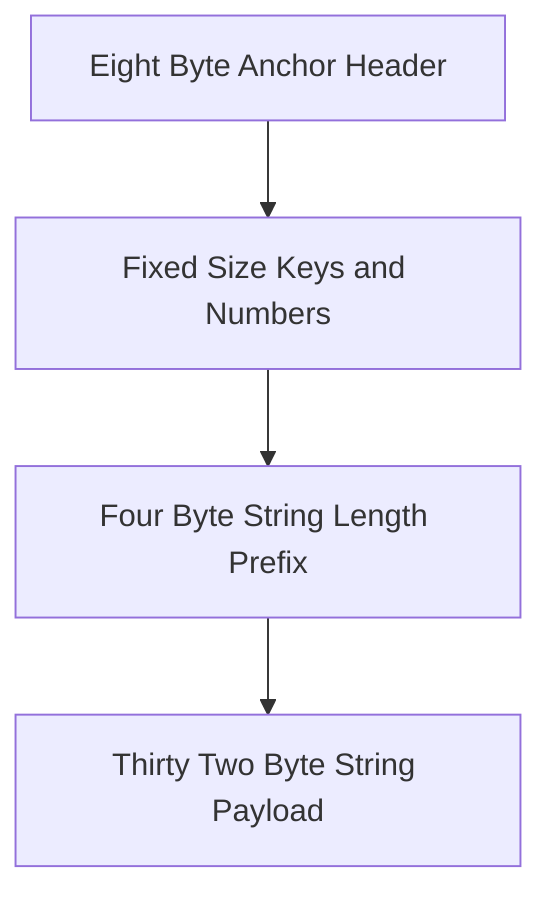

# Accounts and Rent

On Solana, all state lives inside accounts. An account is a storage buffer held in validator memory.

## What is Rent

Rent is a deposit of SOL lamports required to keep an account active in memory. If an account holds enough lamports to cover two years of storage, it is rent-exempt and stays open indefinitely. In Anchor, accounts are created rent-exempt by default.



## Space Calculations

Every Anchor account starts with an 8-byte discriminator that identifies its account type.

### 1. LoyaltyProgram Space (142 bytes)
From `programs/pointpass/src/state/loyalty_program.rs`:
- 8 bytes: Anchor discriminator
- 32 bytes: `merchant` (`Pubkey`)
- 32 bytes: `points_mint` (`Pubkey`)
- 8 bytes: `reward_cost` (`u64`)
- 8 bytes: `total_awarded` (`u64`)
- 8 bytes: `total_redeemed` (`u64`)
- 8 bytes: `redemption_count` (`u64`)
- 1 byte: `bump` (`u8`)
- 1 byte: `mint_bump` (`u8`)
- 36 bytes: `name` (`String`, 4-byte prefix + 32-byte max payload)
- Total = 142 bytes.

### 2. RedemptionReceipt Space (97 bytes)
From `programs/pointpass/src/state/receipt.rs`:
- 8 bytes: Anchor discriminator
- 32 bytes: `customer` (`Pubkey`)
- 32 bytes: `loyalty_program` (`Pubkey`)
- 8 bytes: `points_burned` (`u64`)
- 8 bytes: `receipt_number` (`u64`)
- 8 bytes: `timestamp` (`i64`)
- 1 byte: `bump` (`u8`)
- Total = 97 bytes.

## Why String Needs 4 Extra Bytes

Borsh serializes dynamic types by prefixing the raw content with its byte length as a 4-byte little-endian `u32`. A 32-byte string needs 4 length bytes plus 32 data bytes, totaling 36 bytes.

## Real Code Snippet

From `programs/pointpass/src/state/receipt.rs`:
```rust
pub const LEN: usize = 8  // 8-byte Anchor discriminator
    + 32                  // customer (Pubkey)
    + 32                  // loyalty_program (Pubkey)
    + 8                   // points_burned (u64)
    + 8                   // receipt_number (u64)
    + 8                   // timestamp (i64)
    + 1;                  // bump (u8)
```

## Say it in an interview

Solana accounts must deposit minimum lamports to achieve rent exemption and persist in memory. We calculate account space by summing the 8-byte Anchor discriminator, all primitive fields, and dynamic type overhead. Strings serialized with Borsh require 4 extra bytes to store the length prefix before the character bytes.

## Check yourself

1. What purpose does the initial 8-byte discriminator serve in an Anchor account?
2. How many total bytes does `LoyaltyProgram` occupy, and how is `name` sized?
3. Who pays the rent lamports when a new `RedemptionReceipt` is initialized during redemption?
