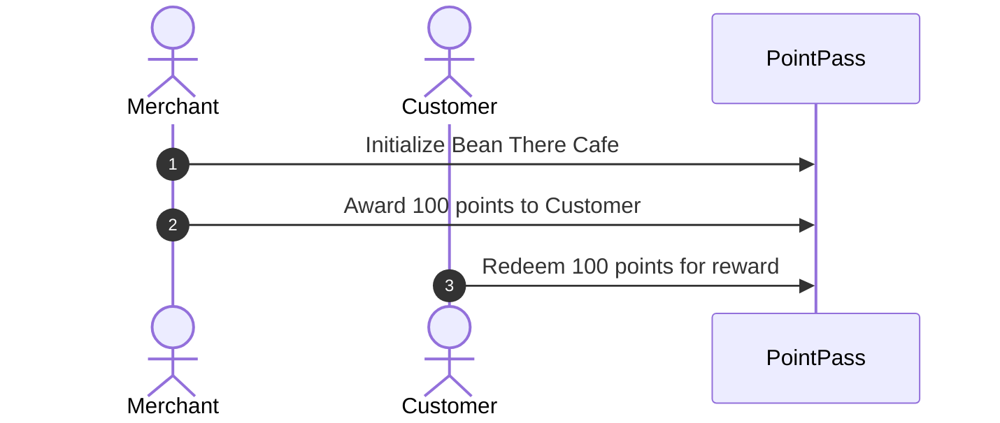

# Award and Redeem Flow

This guide walks through the life of PointPass using Bean There Cafe as the example business.



## Step 1: Initialize Program

The owner of Bean There Cafe sets up their loyalty program on-chain.

- Instruction: `initialize_program` in `programs/pointpass/src/instructions/initialize_program.rs`.
- Key Accounts: `merchant` (signer, pays rent), `loyalty_program` (PDA state), `points_mint` (PDA token mint).
- Action: Sets `name = "Bean There Cafe"`, `reward_cost = 100`, creates zero-decimal mint, and initializes all counters to zero.

## Step 2: Award Points

A customer buys coffee, and Bean There Cafe awards them 100 points.

- Instruction: `award_points` in `programs/pointpass/src/instructions/award_points.rs`.
- Key Accounts: `merchant` (signer), `loyalty_program`, `points_mint`, `customer`, `customer_token_account`.
- Action: The merchant pays rent for the customer associated token account if it does not exist yet (`init_if_needed`). The program PDA signs a `mint_to` CPI for 100 tokens. The program adds 100 to `total_awarded` and emits `PointsAwarded`.

## Step 3: Redeem Points

The customer returns to redeem 100 points for a free pastry.

- Instruction: `redeem` in `programs/pointpass/src/instructions/redeem.rs`.
- Key Accounts: `customer` (signer, pays rent), `loyalty_program`, `points_mint`, `customer_token_account`, `receipt`.
- Action: Checks that the customer balance is at least `reward_cost`. The customer signs a `burn` CPI directly to destroy 100 tokens. The program initializes a `RedemptionReceipt` at index 0, increases `total_redeemed` by 100, increments `redemption_count` to 1, and emits `PointsRedeemed`.

## Real Code Snippet

From `programs/pointpass/src/instructions/redeem.rs`:
```rust
require!(
    ctx.accounts.customer_token_account.amount >= reward_cost,
    PointPassError::InsufficientPoints
);
token::burn(cpi_ctx, reward_cost)?;
receipt.points_burned = reward_cost;
receipt.receipt_number = current_redemption_index;
```

## Say it in an interview

Bean There Cafe initializes a loyalty program that controls its own zero-decimal SPL mint via a PDA. When a customer earns points, the merchant funds their token account creation and the program mints tokens. During redemption, the customer burns their tokens directly, creating an on-chain receipt while updating global program counters.

## Check yourself

1. Why does the merchant pay the rent when creating the customer token account during `award_points`?
2. What event is emitted after a customer successfully redeems their points?
3. What changes occur to the token supply of `points_mint` during a redemption?
