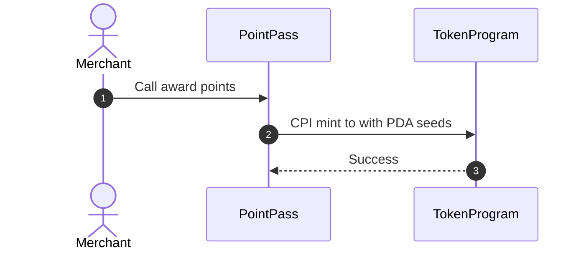

# Cross-Program Invocations

A Cross-Program Invocation occurs when one Solana program calls an instruction on another on-chain program. PointPass uses CPIs to interact with the standard SPL Token Program.

## How Award Points Signs via CPI

When awarding points, the loyalty program issues new tokens. The mint authority of `points_mint` is the `LoyaltyProgram` PDA, not a human wallet.

Because a PDA has no private key, the runtime signs for it using seeds and the stored bump. PointPass bundles these into `CpiContext::new_with_signer` to call `token::mint_to`.



## Why Redeem Needs No PDA Signing

In `redeem`, tokens are burned from the customer account instead of being minted.

1. The customer owns the tokens in `customer_token_account`.
2. The account constraint enforces `token::authority = customer`.
3. The customer is already an active signer on the transaction.
4. PointPass uses `CpiContext::new` without seeds because the customer signs directly.

## Real Code Snippet

From `programs/pointpass/src/instructions/award_points.rs`:
```rust
let seeds = &[LOYALTY_PROGRAM_SEED, merchant_key.as_ref(), &[bump]];
let signer_seeds = &[&seeds[..]];
let cpi_ctx = CpiContext::new_with_signer(
    cpi_program,
    cpi_accounts,
    signer_seeds,
);
token::mint_to(cpi_ctx, amount)?;
```

## Say it in an interview

A CPI lets our program invoke instructions on external programs like the SPL Token Program. When minting points, the program derives PDA signer seeds so the runtime can authorize the mint authority. When burning points during redemption, no PDA signature is needed because the customer signs the burn as the token owner.

## Check yourself

1. Why does `token::mint_to` require `new_with_signer` in PointPass?
2. What account constraint ensures that only the customer can burn their loyalty points?
3. What would happen if `award_points` used `CpiContext::new` without seeds?
