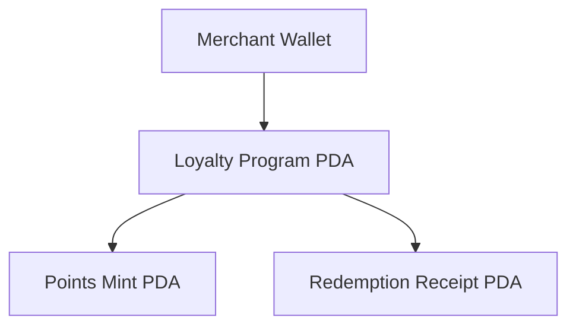

# Program Derived Addresses

A Program Derived Address is an account address that has no private key. It is owned and controlled by a smart contract.

## How a PDA Works

Solana creates a PDA by hashing seeds and a program ID until the point falls off the Ed25519 elliptic curve. Because it lies off the curve, no private key exists. Only the program can sign for it.

The bump is a single number from 255 down to 0 that pushes the address off the curve. Finding this bump costs compute units. PointPass saves the bump in account storage so future calls verify the address instantly.



## The Three PDAs in PointPass

1. Loyalty Program PDA:
   - Stores configuration, counters, and merchant authority.
   - Seed: `[b"loyalty", loyalty_program.merchant.as_ref()]`.
   - File: `programs/pointpass/src/instructions/initialize_program.rs`.

2. Points Mint PDA:
   - The SPL mint that issues zero-decimal point tokens.
   - Seed: `[b"mint", loyalty_program.key().as_ref()]`.
   - File: `programs/pointpass/src/instructions/initialize_program.rs`.

3. Redemption Receipt PDA:
   - Permanent proof that a customer burned points for a reward.
   - Seed: `[b"redemption", loyalty_program.key().as_ref(), customer.key().as_ref(), &redemption_count.to_le_bytes()]`.
   - File: `programs/pointpass/src/instructions/redeem.rs`.

## Real Code Snippet

From `programs/pointpass/src/instructions/redeem.rs`:
```rust
seeds = [
    REDEMPTION_SEED,
    loyalty_program.key().as_ref(),
    customer.key().as_ref(),
    &loyalty_program.redemption_count.to_le_bytes(),
],
bump,
```

## Say it in an interview

A PDA is a deterministic address without a private key that only its owning program can sign for. We store the canonical bump directly in account data to avoid recalculating it on every instruction. In PointPass, each redemption receipt uses the customer key and a counter in its seeds so every receipt is unique.

## Check yourself

1. Why is it impossible for a user wallet to sign on behalf of a PDA?
2. What happens to transaction compute costs if you do not store the bump in the account?
3. Which seeds prevent two customers from overwriting each others redemption receipts?
