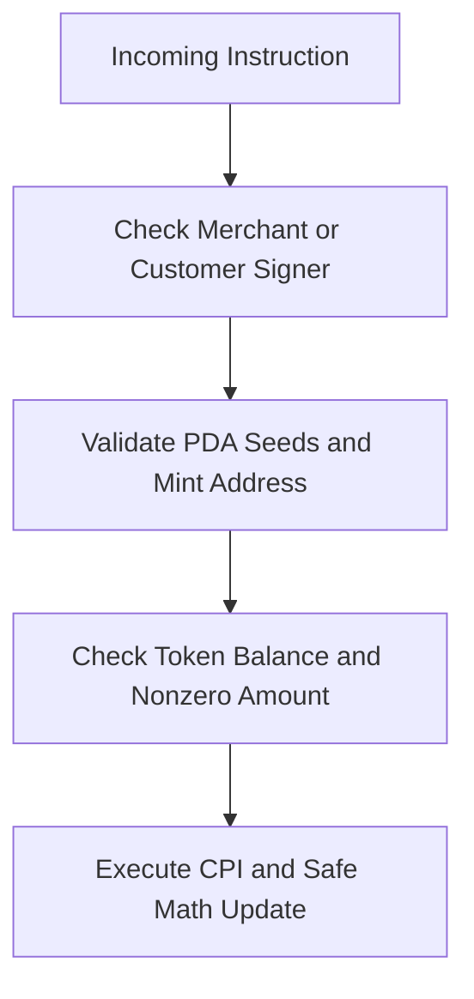

# Security Checks and Constraints

PointPass implements layered security checks across every instruction to safeguard merchant and customer funds.



## Security Checks in the Code

1. Merchant Authority Check:
   - Check: `has_one = merchant @ PointPassError::Unauthorized`
   - File: `programs/pointpass/src/instructions/award_points.rs`
   - Attack prevented: An attacker cannot sign `award_points` for a program they do not own.

2. Seeds from Stored Merchant:
   - Check: `seeds = [LOYALTY_PROGRAM_SEED, loyalty_program.merchant.as_ref()]`
   - File: `programs/pointpass/src/instructions/award_points.rs` and `redeem.rs`
   - Attack prevented: Seeds from the stored merchant make Anchor verify the real PDA and let has_one return Unauthorized instead of AccountNotInitialized.

3. Customer Token Ownership:
   - Check: `token::authority = customer`
   - File: `programs/pointpass/src/instructions/redeem.rs`
   - Attack prevented: A rogue caller cannot burn loyalty points from another customer account.

4. Mint Address Validation:
   - Check: `address = loyalty_program.points_mint`
   - File: `programs/pointpass/src/instructions/award_points.rs` and `redeem.rs`
   - Attack prevented: Prevents an attacker from passing a malicious or counterfeit token mint.

5. Checked Math Operations:
   - Check: `.checked_add(...).ok_or(PointPassError::MathOverflow)?`
   - File: `programs/pointpass/src/instructions/award_points.rs` and `redeem.rs`
   - Attack prevented: Prevents integer overflow from corrupting loyalty counters.

6. Strictly Positive Amount:
   - Check: `require!(amount > 0, PointPassError::InvalidAmount)`
   - File: `programs/pointpass/src/instructions/award_points.rs`
   - Attack prevented: Blocks zero-token spam transactions that clutter indexer logs.

7. Scoped `init_if_needed`:
   - Check: Used only on `customer_token_account`, payer is merchant.
   - File: `programs/pointpass/src/instructions/award_points.rs`
   - Attack prevented: Prevents re-initialization exploits on state accounts while offering seamless UX for customer token accounts.

8. Program Name Length:
   - Check: `require!(name.as_bytes().len() <= MAX_NAME_LENGTH, PointPassError::NameTooLong);`
   - File: `programs/pointpass/src/instructions/initialize_program.rs`
   - Attack prevented: Prevents writing past allocated account space (32 bytes).

## Honest Limitation

1. Global Counter Serialization:
   `redemption_count` is stored directly on `LoyaltyProgram`. Every redemption writes to this single account. Simultaneous redemptions collide on the same count, forcing the second client to re-fetch the latest counter and retry.

## Real Code Snippet

From `programs/pointpass/src/instructions/redeem.rs`:
```rust
#[account(
    mut,
    token::mint = points_mint,
    token::authority = customer,
)]
pub customer_token_account: Account<'info, TokenAccount>,
```

## Say it in an interview

PointPass combines Anchor constraints like `has_one` and `token::authority` with checked math to eliminate unauthorized actions and arithmetic exploits. We intentionally limit `init_if_needed` to token accounts so core program state cannot be reinitialized. A known trade-off is the global redemption counter, which serializes redemptions and requires client retries under high concurrency.

## Check yourself

1. Why is `init_if_needed` safe on the customer token account but dangerous on custom program state?
2. What error code is returned if an attacker calls `award_points` on another merchant program?
3. How does burning points first allow an integration test to reach MathOverflow in award_points?
